# Mikke — DB基本設計 v1.1（確定）

- 対象: 社内専用の軽量CMDB
- データベース: PostgreSQL
- 関連文書: Mikke MVP要件定義、インベントリ台帳の Servers / Software / Repositories という管理単位
- ステータス: **基本設計方針と論理スキーマ確定**（DDLの物理詳細、UI/APIの実装順序は別途）

## 1. 確定事項と設計原則

1. **個別インスタンス管理**: PostgreSQL・Redis・SQSなどは、サーバーの文字列属性ではなく独立した `service_instances` として登録する。同一サーバー上の複数インスタンスを区別できる。
2. **正本の使い分け**: デプロイは `deployments`、アプリとリポジトリの関係は `application_repositories`、サーバーへのソフト導入は `software_installations`、サービスのホスト先は `service_instances.host_compute_id`、通信・論理依存は `resource_relations` が正本。**同じ事実を複数の正本に書かない。**
3. **アーカイブを基本**: 参照があるリソースは物理削除しない。`resources.archived_at` を設定し、履歴・関連情報を残す。アーカイブ済みの対象がある依存関係は「要確認」として認識可能にする。
4. **Canvasはビュー兼エディタ**: 資源と関係の正本はDB。Canvasは表示座標と非表示指定だけを管理し、接続・削除時には対応する正本をAPI経由で更新する。
5. **Web登録・Agent入力から開始**: SSHやクラウドAPIによる自動収集、外部EOLデータの自動同期、CVE照合、リアルタイム共同編集、汎用ホワイトボードはMVP対象外。
6. **内部利用・Agent書き込み**: Web/API/MCPを自社の認証済み主体に限定。MCPはMVPから読み書き対応（POST/PUT相当の作成・更新ツール）。権限をread/writeに分離し、監査記録を必須とする。認証情報や秘密鍵・パスワードをDBに格納しない。
7. **EOLの正本はMikke・対象は利用中の資産のみ**: DADADAには依存しない。Mikkeに登録された自社の利用中・管理対象のOS、ソフトウェア、サービスインスタンスに対応する製品・リリース系列だけをEOL管理する。Agentが公開一次情報を調査し、根拠・確認日時とともにMikkeへ登録・更新する。外部EOLサイトの自動同期や、未使用製品を網羅するEOLデータベースの構築はMVP対象外。

## 2. 全体ER図

```mermaid
erDiagram
    resources ||--o| compute_assets : "compute detail"
    resources ||--o| applications : "application detail"
    resources ||--o| service_instances : "service detail"
    resources ||--o| repositories : "repository detail"

    compute_assets |o--o{ service_instances : "hosts (optional)"
    applications ||--o{ deployments : "deployed as"
    resources ||--o{ deployments : "deployment target"
    repositories |o--o{ deployments : "source revision"

    applications ||--o{ application_repositories : "source repositories"
    repositories ||--o{ application_repositories : "used by"

    compute_assets ||--o{ software_installations : "installed on"
    software_products ||--o{ software_installations : "product"
    software_products ||--o{ software_release_cycles : "release cycles"
    software_release_cycles ||--o{ software_lifecycle_events : "lifecycle events"
    software_release_cycles |o--o{ software_installations : "matched installations"
    software_release_cycles |o--o{ service_instances : "matched service engines"

    relation_types ||--o{ resource_relations : "classifies"
    resources ||--o{ resource_relations : "source"
    resources ||--o{ resource_relations : "target"

    diagrams ||--o{ diagram_nodes : "contains"
    resources ||--o{ diagram_nodes : "renders"
    diagrams ||--o{ diagram_hidden_edges : "hides"

    resources {
      uuid id PK
      varchar resource_type
      varchar name
      varchar lifecycle_status
      timestamptz archived_at
    }
    compute_assets {
      uuid resource_id PK,FK
      varchar hostname
      varchar provider
    }
    applications {
      uuid resource_id PK,FK
      text description
    }
    service_instances {
      uuid resource_id PK,FK
      varchar service_kind
      uuid host_compute_id FK
      varchar engine
      uuid software_product_id FK
      uuid release_cycle_id FK
    }
    repositories {
      uuid resource_id PK,FK
      text repository_url
    }
    application_repositories {
      uuid id PK
      uuid application_id FK
      uuid repository_id FK
    }
    deployments {
      uuid id PK
      uuid application_id FK
      uuid target_resource_id FK
      uuid repository_id FK
      varchar environment
    }
    software_products {
      uuid id PK
      varchar name
    }
    software_installations {
      uuid id PK
      uuid compute_asset_id FK
      uuid software_product_id FK
      varchar version
      uuid release_cycle_id FK
    }
    software_release_cycles {
      uuid id PK
      uuid software_product_id FK
      varchar cycle
      varchar match_pattern
      varchar verification_status
    }
    software_lifecycle_events {
      uuid id PK
      uuid release_cycle_id FK
      varchar event_type
      date event_date
      text source_url
    }
    relation_types {
      varchar code PK
      varchar direction_semantics
    }
    resource_relations {
      uuid id PK
      uuid source_resource_id FK
      uuid target_resource_id FK
      varchar relation_type FK
    }
    diagrams {
      uuid id PK
      varchar name
    }
    diagram_nodes {
      uuid id PK
      uuid diagram_id FK
      uuid resource_id FK
    }
    diagram_hidden_edges {
      uuid diagram_id FK
      varchar edge_kind
      uuid edge_record_id
    }
    audit_logs {
      uuid id PK
      varchar actor_id
      varchar entity_type
      uuid entity_id
    }
```

> 図の `resources → deployments` は「配置先Resource」の参照。配置可能な種別はAPIで `compute` または `service_instance` のうちホスティング種別に制限する。`diagram_hidden_edges` は異種の関係正本を示すためFKで直接結ばず、整合性は後述の方針で担保する。

## 3. テーブル一覧（17テーブル）

| # | テーブル | 正本となる情報 |
|---|---|---|
| 1 | `resources` | 全ノード共通ID、表示名、ライフサイクル |
| 2 | `compute_assets` | VPS / EC2 / VM / 物理ホスト |
| 3 | `applications` | 論理アプリケーション |
| 4 | `service_instances` | DB / Redis / Queue / Storage / Managed Hosting の個別インスタンス |
| 5 | `repositories` | Gitリポジトリ |
| 6 | `application_repositories` | アプリとソースリポジトリの対応 |
| 7 | `deployments` | アプリの配置・環境・リビジョン |
| 8 | `software_products` | ソフトウェア製品マスタ |
| 9 | `software_installations` | Computeに導入されたソフトとバージョン |
| 10 | `relation_types` | 通信・利用・論理依存の許可種別 |
| 11 | `resource_relations` | 通信・利用・論理依存の実体 |
| 12 | `diagrams` | 構成図 |
| 13 | `diagram_nodes` | 構成図内の配置 |
| 14 | `diagram_hidden_edges` | 構成図内の線の非表示指定 |
| 15 | `audit_logs` | 変更監査 |
| 16 | `software_release_cycles` | 製品のリリース系列と照合規則 |
| 17 | `software_lifecycle_events` | リリース系列のサポート段階・終了日・根拠 |

全UUIDの初期値は `gen_random_uuid()` を想定。全時刻は `timestamptz`、時刻保存はUTC。`created_at` / `updated_at` の更新はアプリまたはDBの共通処理で徹底する。

## 4. テーブル定義

表記: **PK** 主キー、**FK** 外部キー、**UQ** 一意、**NN** NOT NULL。特記のない文字列/JSONは NULL 可。

### 4.1 `resources`

| カラム | 型 | 制約 | 用途 |
|---|---|---|---|
| `id` | uuid | PK | どの種別にも共通のResource ID |
| `resource_type` | varchar(32) | NN | `compute` / `application` / `service_instance` / `repository` |
| `name` | varchar(255) | NN | 表示名 |
| `description` | text | | 備考 |
| `environment` | varchar(32) | | prod / stg / dev 等。論理アプリやリポジトリではNULL可 |
| `lifecycle_status` | varchar(32) | NN, default `active` | active / maintenance / retired |
| `last_verified_at` | timestamptz | | 情報の最終確認 |
| `archived_at` | timestamptz | | 論理アーカイブ日時 |
| `created_at` | timestamptz | NN | 作成日時 |
| `updated_at` | timestamptz | NN | 更新日時 |

制約: `resource_type` はDB CHECK。`retired`（運用状態）と `archived_at`（台帳の通常表示対象外）は分離する。種別詳細と共通行は**同一トランザクションで作成**。種別変更は原則禁止し、再登録/移行操作とする。

### 4.2 `compute_assets`

| カラム | 型 | 制約 | 用途 |
|---|---|---|---|
| `resource_id` | uuid | PK, FK → resources.id | 対象Compute |
| `asset_kind` | varchar(32) | NN | vps / vm / ec2 / baremetal / container_host |
| `hostname` | varchar(255) | | ホスト名 |
| `display_alias` | varchar(255) | | 管理用別名 |
| `provider` | varchar(100) | | Sakura / AWSなど |
| `region` | varchar(100) | | リージョン/DC |
| `os_name` | varchar(100) | | OS |
| `os_version` | varchar(100) | | OSバージョン |
| `os_software_product_id` | uuid | FK → software_products.id | OS製品マスタ |
| `os_release_cycle_id` | uuid | FK → software_release_cycles.id | OSのEOL照合系列 |
| `architecture` | varchar(32) | | arm64 / x86_64など |
| `public_ip` | inet | | 公開IP（任意） |
| `private_ip` | inet | | 内部IP（任意） |
| `attributes` | jsonb | NN, default `{}` | その他種別固有項目 |

ホスト名やIPは一意と決めつけない（ネットワーク・環境・再利用の事情があるため）。識別にはResource IDを使う。

### 4.3 `applications`

| カラム | 型 | 制約 | 用途 |
|---|---|---|---|
| `resource_id` | uuid | PK, FK → resources.id | 論理アプリ |
| `framework` | varchar(100) | | Laravel / Echo / Next.jsなど |
| `framework_version` | varchar(100) | | 宣言上の版 |
| `runtime` | varchar(100) | | PHP / Go / Node.jsなど |
| `runtime_requirement` | varchar(100) | | 要求バージョン範囲（文字列） |
| `build_tool` | varchar(100) | | Viteなど |
| `attributes` | jsonb | NN, default `{}` | 補助情報 |

実際の稼働リビジョンは `deployments`、ホスト上のインストール済み版は `software_installations` の正本。

### 4.4 `service_instances`

| カラム | 型 | 制約 | 用途 |
|---|---|---|---|
| `resource_id` | uuid | PK, FK → resources.id | 個別インスタンス |
| `service_kind` | varchar(32) | NN | database / cache / queue / storage / hosting / other |
| `engine` | varchar(100) | | PostgreSQL / Redis / SQS / Cloud Runなど |
| `engine_version` | varchar(100) | | 実稼働バージョン |
| `software_product_id` | uuid | FK → software_products.id | EOL照合する製品。未特定ならNULL |
| `release_cycle_id` | uuid | FK → software_release_cycles.id | 確認済みリリース系列。未照合ならNULL |
| `provider` | varchar(100) | | AWS / Supabase / self-hosted等 |
| `is_managed` | boolean | NN, default false | マネージドか |
| `host_compute_id` | uuid | FK → compute_assets.resource_id | セルフホスト時の配置元。NULL可 |
| `endpoint` | text | | 公開可能な接続先識別子。認証情報は禁止 |
| `attributes` | jsonb | NN, default `{}` | サービス固有情報 |

例: 同じVPSの `postgres-main` と `redis-cache` はそれぞれ別の `resources` + `service_instances`。SQSは `host_compute_id = NULL`。セルフホストのDBであっても、**ソフトウェア製品のインストールという事実**は `software_installations` に別途記録できる（製品導入と稼働サービスは別概念）。

### 4.5 `repositories`

| カラム | 型 | 制約 | 用途 |
|---|---|---|---|
| `resource_id` | uuid | PK, FK → resources.id | Repository Resource |
| `provider` | varchar(50) | | GitHub等 |
| `repository_url` | text | NN, UQ | 正規化したURL |
| `default_branch` | varchar(255) | | 既定ブランチ |

### 4.6 `application_repositories`

| カラム | 型 | 制約 | 用途 |
|---|---|---|---|
| `id` | uuid | PK | 対応ID |
| `application_id` | uuid | NN, FK → applications.resource_id | アプリ |
| `repository_id` | uuid | NN, FK → repositories.resource_id | リポジトリ |
| `purpose` | varchar(32) | NN, default `source` | source / config / infra / other |
| `created_at` | timestamptz | NN | 作成日時 |

`UNIQUE(application_id, repository_id, purpose)`。モノレポ・複数Repoを許容。

### 4.7 `deployments`

| カラム | 型 | 制約 | 用途 |
|---|---|---|---|
| `id` | uuid | PK | 配置レコードID |
| `application_id` | uuid | NN, FK → applications.resource_id | アプリ |
| `target_resource_id` | uuid | NN, FK → resources.id | ComputeまたはHostingサービス |
| `repository_id` | uuid | FK → repositories.resource_id | 使用Repo（NULL可） |
| `environment` | varchar(32) | NN | prod / stg / dev |
| `deploy_path` | text | | パス/サービス名等 |
| `deploy_method` | varchar(100) | | GH Actions / 手動など |
| `revision` | varchar(255) | | SHA / image digest等 |
| `status` | varchar(32) | NN, default `active` | active / inactive |
| `deployed_at` | timestamptz | | デプロイ日時 |
| `created_at` | timestamptz | NN | 作成日時 |
| `updated_at` | timestamptz | NN | 更新日時 |

APIは `target_resource_id` の種別を検証: `compute` は可、`service_instance` は `service_kind = hosting` のみ可。`repository_id` がNULLでない場合、当該アプリとの `application_repositories` の組も検証する（MVPでは強制する方針）。同一アプリの複数台展開、複数環境、複数世代を許容するため、単純な `(application_id, environment)` の一意制約は設けない。

### 4.8 `software_products`

| カラム | 型 | 制約 | 用途 |
|---|---|---|---|
| `id` | uuid | PK | ソフト製品ID |
| `name` | varchar(255) | NN | PHP, nginx等 |
| `normalized_name` | varchar(255) | NN | 検索用正規化名 |
| `vendor` | varchar(255) | | ベンダー名 |
| `category` | varchar(50) | | runtime / webserver / utility等 |

同名でもvendor違いを許容。CPE/purlなど識別子が必要になったらPhase 2で別カラム・識別子テーブルを追加。

### 4.9 `software_installations`

| カラム | 型 | 制約 | 用途 |
|---|---|---|---|
| `id` | uuid | PK | 導入実体 |
| `compute_asset_id` | uuid | NN, FK → compute_assets.resource_id | 導入先 |
| `software_product_id` | uuid | NN, FK → software_products.id | 製品 |
| `version` | varchar(255) | | 実際の版 |
| `release_cycle_id` | uuid | FK → software_release_cycles.id | EOL照合系列。未照合ならNULL |
| `install_method` | varchar(100) | | apt / binary / composer / manual等 |
| `install_path` | text | | 複数版区別に利用 |
| `config_path` | text | | 設定パス |
| `last_verified_at` | timestamptz | | 確認日時 |
| `created_at` | timestamptz | NN | 登録日時 |
| `updated_at` | timestamptz | NN | 更新日時 |

同一ホストで同製品の複数版・複数パスを許容するため単純なサーバー×製品のUQは設けない。

### 4.9a `software_release_cycles`（追加）

製品ごとのEOL判定単位（例: PHP 8.4、Node.js 22、PostgreSQL 16）。パッチバージョンと系列を混同しない。

| カラム | 型 | 制約 | 用途 |
|---|---|---|---|
| `id` | uuid | PK | リリース系列ID |
| `software_product_id` | uuid | NN, FK → software_products.id | 製品 |
| `cycle` | varchar(100) | NN | 8.4 / 22 / 16 等 |
| `match_pattern` | varchar(255) | | バージョン照合規則。安全な限定構文を採用し、任意正規表現の実行は避ける |
| `verification_status` | varchar(32) | NN, default `unverified` | unverified / verified / disputed |
| `verified_at` | timestamptz | | 一次情報との照合確認日時 |
| `verified_by` | varchar(255) | | 確認した人・Agentの識別子 |
| `notes` | text | | 補足 |
| `created_at` | timestamptz | NN | 登録日時 |
| `updated_at` | timestamptz | NN | 更新日時 |

`UNIQUE(software_product_id, cycle)`。製品が違えば同じ系列名を許容する。`software_installations` / `service_instances` の `release_cycle_id` は、対象の `software_product_id` と同じ製品に属することをアプリケーションサービスで検証する。実装時は複合FKによるDB制約も検討する。

### 4.9b `software_lifecycle_events`（追加）

EOL情報の正本。終了日を一つだけ持つのではなく、製品ごとのサポート段階を記録する。

| カラム | 型 | 制約 | 用途 |
|---|---|---|---|
| `id` | uuid | PK | イベントID |
| `release_cycle_id` | uuid | NN, FK → software_release_cycles.id | リリース系列 |
| `event_type` | varchar(50) | NN | release / active_support_end / security_support_end / eol |
| `event_date` | date | NN | 公式に示された日付 |
| `source_url` | text | NN | 根拠となる一次情報URL |
| `source_title` | text | | 公式文書名 |
| `checked_at` | timestamptz | NN | Agent等が根拠を確認した日時 |
| `recorded_by` | varchar(255) | NN | 人またはAgentの識別子 |
| `notes` | text | | 解釈・例外・注意事項 |
| `created_at` | timestamptz | NN | 登録日時 |
| `updated_at` | timestamptz | NN | 更新日時 |

`UNIQUE(release_cycle_id, event_type)`。日付変更は既存行を更新し、`audit_logs` に変更前後と操作主体を残す。**不明な日付は架空のイベントを作らず、イベント未登録として表す。** 公式に明示された終了日と、推定日を混同しない。推定値を扱う必要が出た場合は別途 `date_confidence` 等を追加する。

### 4.10 `relation_types`

| カラム | 型 | 制約 | 用途 |
|---|---|---|---|
| `code` | varchar(50) | PK | 種別コード |
| `label` | varchar(100) | NN | UI表示名 |
| `description` | text | | 意味・向き |
| `is_directed` | boolean | NN, default true | 方向を持つか |
| `is_active` | boolean | NN, default true | 登録候補に出すか |

初期値: `depends_on`, `connects_to`, `uses`, `publishes_to`, `consumes_from`。`hosted_on`, `deployed_on`, `managed_by`, `installed_on` は**専用テーブルから導出するため登録対象にしない**。既存リレーションがあるタイプを無条件で削除しない。

### 4.11 `resource_relations`

| カラム | 型 | 制約 | 用途 |
|---|---|---|---|
| `id` | uuid | PK | 関係ID |
| `source_resource_id` | uuid | NN, FK → resources.id | 関係元 |
| `target_resource_id` | uuid | NN, FK → resources.id | 関係先 |
| `relation_type` | varchar(50) | NN, FK → relation_types.code | 種別 |
| `description` | text | | 根拠や注記 |
| `created_at` | timestamptz | NN | 登録日時 |
| `updated_at` | timestamptz | NN | 更新日時 |

制約: `CHECK(source_resource_id <> target_resource_id)`、`UNIQUE(source_resource_id, target_resource_id, relation_type)`。MVPは同種同方向の関係は1件とし、プロトコルやポートなどは追加属性が必要になれば拡張。例: `BFF --uses--> Redis`, `API --publishes_to--> SQS`, `Worker --consumes_from--> SQS`。`consumes_from` は**Worker→SQS**の向きで保存する。

### 4.12 `diagrams`

| カラム | 型 | 制約 | 用途 |
|---|---|---|---|
| `id` | uuid | PK | 図ID |
| `name` | varchar(255) | NN | 図名称 |
| `description` | text | | 説明 |
| `viewport` | jsonb | NN, default `{}` | `{x,y,zoom}` |
| `created_at` | timestamptz | NN | 作成 |
| `updated_at` | timestamptz | NN | 更新 |

### 4.13 `diagram_nodes`

| カラム | 型 | 制約 | 用途 |
|---|---|---|---|
| `id` | uuid | PK | ノード表示ID |
| `diagram_id` | uuid | NN, FK → diagrams.id | 構成図 |
| `resource_id` | uuid | NN, FK → resources.id | 表示Resource |
| `position_x` | double precision | NN | X座標 |
| `position_y` | double precision | NN | Y座標 |
| `display_options` | jsonb | NN, default `{}` | 折りたたみなど |

`UNIQUE(diagram_id, resource_id)`。ノード除去は図からの除去だけで、正本Resourceは削除しない。

### 4.14 `diagram_hidden_edges`

| カラム | 型 | 制約 | 用途 |
|---|---|---|---|
| `diagram_id` | uuid | NN, FK → diagrams.id | 対象図 |
| `edge_kind` | varchar(32) | NN | `relation` / `deployment` / `hosting` / `app_repository` |
| `edge_record_id` | uuid | NN | 元レコードID |
| `created_at` | timestamptz | NN | 設定日時 |

複合PK `(diagram_id, edge_kind, edge_record_id)`。アプリケーション API が各 `edge_kind` の元レコードの存在を検査。物理削除時にはこのテーブルもクリーンアップする。DBの通常FKだけでは異種テーブルに対する参照を張れない点は既知のトレードオフ。

### 4.15 `audit_logs`

| カラム | 型 | 制約 | 用途 |
|---|---|---|---|
| `id` | uuid | PK | 監査ID |
| `actor_id` | varchar(255) | NN | 管理者または内部Agent識別子 |
| `action` | varchar(50) | NN | create / update / archive / restore / delete 等 |
| `entity_type` | varchar(100) | NN | テーブル/ドメイン |
| `entity_id` | uuid | NN | 対象ID |
| `before_data` | jsonb | | 変更前 |
| `after_data` | jsonb | | 変更後 |
| `created_at` | timestamptz | NN | 操作日時 |

機密値・アクセストークンなどをログに含めない。正本変更と監査記録は原則同一トランザクション。

## 5. 図に出すエッジの導出規則

Canvas/MCP向けGraph APIは、各正本から次の共通表現を組み立てる（Graph用に二重保存しない）。

| `edge_kind` | 正本 | 表示上の接続 | ラベル |
|---|---|---|---|
| `relation` | `resource_relations.id` | `source_resource_id → target_resource_id` | relation_type |
| `deployment` | `deployments.id` | `application_id → target_resource_id` | deployed_on |
| `hosting` | `service_instances.resource_id` | `service_instance.resource_id → host_compute_id` | hosted_on |
| `app_repository` | `application_repositories.id` | `application_id → repository_id` | sourced_from |

`software_installations` はProductがResourceではないためMVPのCanvasエッジ対象外。資産詳細パネルに表示する。ソフト製品もノード化したい要件が出たら後で昇格を検討する。

表示ルール: **両端のResourceがその図に配置されているエッジだけ**表示。`diagram_hidden_edges` に一致するものを除外。通常画面ではアーカイブ済みノードを淡色・警告付き表示するか非表示にするかをUIで選べるが、依存関係自体を削除してはならない。

## 6. 双方向Canvas編集と整合性

1. ノードの追加・移動・図からの除去 → `diagram_nodes` のみ更新。
2. `BFF → Redis (uses)` の接続作成 → `resource_relations` INSERT。DB成功後に線を確定表示。
3. `BFF → VPS (deployed_on)` の接続作成 → `deployments` 登録フォームへ誘導。`environment` など必要値を入力して保存。
4. `PostgreSQL → VPS (hosted_on)` の接続作成 → `service_instances.host_compute_id` UPDATE。
5. `Application → Repo (sourced_from)` の接続作成 → `application_repositories` INSERT。
6. Canvas上の線の「この図で隠す」→ `diagram_hidden_edges` INSERT。別の図やMCPへ影響しない。
7. Canvas上の「正本の関係を削除」→ 関連正本を削除/解除。影響範囲を確認表示し監査ログに記録。全図・MCPに反映。
8. 競合対策: MVPは更新成功後に正本を再取得する方式。後日、`updated_at` または `version` による楽観ロックを追加する。

注: `resource_relations` は単方向の意味を持つ。`depends_on` の向きと障害の影響伝播方向は同じではない。機械的な影響判定は別ロジックとする。

## 7. アーカイブと削除ポリシー

- `DELETE /resources/{id}` は通常提供しない。標準操作は **archive**（`archived_at` 設定）。
- アーカイブ前に、デプロイ、サービスのホスト先、依存関係、アプリとRepoの参照、図上の配置を列挙して確認する。
- アーカイブは参照先の無条件カスケード削除をしない。関連レコードと監査履歴を保持する。
- アーカイブされたリソースが依存先に残っている場合、MCP/APIからその状態を判別できるようにする。
- 復元（unarchive）を用意。物理削除は**参照なし・監査保持を満たす管理用メンテナンス操作**に限定する。
- FKは原則 `ON DELETE RESTRICT/NO ACTION`。`diagram_nodes` 等の純粋な配置情報のみDiagram自体の削除時に `ON DELETE CASCADE` を許容。
- `deployments` や `resource_relations` はResourceのarchiveによって自動削除されない。

## 8. 主なインデックス・一意制約

- `resources(resource_type, archived_at)`、`resources(name)`（検索要件に応じてpg_trgmを検討）。
- `compute_assets(hostname)`（非ユニーク）。
- `service_instances(host_compute_id)`、`service_instances(service_kind, engine)`。
- `deployments(application_id, environment)`、`deployments(target_resource_id)`、`deployments(repository_id)`。
- `application_repositories`: `UNIQUE(application_id, repository_id, purpose)`。
- `software_installations(compute_asset_id)`、`software_installations(software_product_id, version)`。
- `resource_relations`: `UNIQUE(source_resource_id, target_resource_id, relation_type)`、`INDEX(target_resource_id)`。
- `diagram_nodes`: `UNIQUE(diagram_id, resource_id)`。
- `diagram_hidden_edges`: 複合PK `(diagram_id, edge_kind, edge_record_id)`。
- `audit_logs(entity_type, entity_id, created_at DESC)`、`audit_logs(created_at DESC)`。

## 9. APIとMCPが扱うグラフ

- `GET /resources`、`GET /resources/{id}` — 汎用検索・詳細。
- `POST/PATCH /resources/...` — 種別別の登録・更新。詳細テーブル更新を同一TXで行う。
- `POST /resources/{id}/archive`、`POST /resources/{id}/restore` — ライフサイクル。
- `GET /graph?diagram_id=...` — 配置ノードと正本由来のエッジを取得。
- `POST /relations` / `DELETE /relations/{id}` — 論理・通信依存の更新。
- `POST /deployments` / `PATCH /deployments/{id}` — 配置関係の編集。
- `POST /diagrams/{id}/nodes`、`PATCH /diagrams/{id}/nodes/{nodeId}` — 座標・配置。
- `POST /diagrams/{id}/hidden-edges` — エッジ非表示。

MCPは読み取りに加え、**作成・更新**を許可する。MCPのツール名はHTTPメソッドではなく操作を表す動詞を用いる。`create_*` はRESTのPOST相当、`update_*` はPUT/PATCH相当とする。初期ツールは `search_resources`, `get_resource`, `get_application_deployments`, `get_resource_dependencies`, `get_resource_graph`, `search_software_installations`, `list_eol_status`, `get_software_lifecycle`, `create_resource`, `update_resource`, `create_software_release_cycle`, `update_software_release_cycle`, `create_lifecycle_event`, `update_lifecycle_event`, `assign_release_cycle`。既存資産の作成・更新もMCPから行える。

書き込みはWeb/APIと**同じドメインサービス**を通し、検証・一意制約・参照整合性・監査ログを共通化する。MCP専用の直接SQL更新は禁止。`archive_resource`、依存関係の削除、EOLイベントの削除など破壊的操作はMVPのMCPに公開しない。

## 10. 実装順序と受け入れ基準

1. `resources` と種別詳細・ソフト・Repository・Deployment・汎用RelationのDB/API。
2. TestReportPortalに近い手動登録・編集・検索UI。
3. Graph APIとCanvas（React Flowを第一候補）。接続種別ごとに正本更新処理を切り替える。
4. 内部向け読み書きMCP（AgentによるEOL調査結果の登録・更新を含む）。
5. DADADA・SHIORIとの横断検証（別マイルストーン）。

**MVPの受け入れ基準**:

- 1台のVPSにPostgreSQLとRedisを別個のサービスインスタンスとして登録できる。
- 1アプリから本番/ステージングへの複数Deploymentを管理できる。
- `API → PostgreSQL`、`API → Redis`、`API → SQS`、`Worker → SQS` を方向・種別付きで登録・検索できる。
- Canvasの接続作成・削除で対応する正本が変化し、別CanvasとMCPに反映される。
- Canvasで線だけ非表示にしても正本の関係は維持される。
- 参照のあるResourceをアーカイブしても、関連情報と監査ログが失われない。
- 未認証ユーザーは資産データを取得できず、MCPの書き込みは専用権限を持つ主体だけが実行できる。
- Agentが公式根拠URL付きでEOL日付を登録・更新でき、更新履歴と実行主体が追跡できる。
- インストール済みソフトとDB/Redis等のサービス実体をリリース系列へ紐付け、EOL・期限接近・不明を区別できる。

## 11. 将来の拡張余地（MVP外）

- CPE/purlなどの製品識別子、CVEとの照合。EOL自動クローリング・外部データ同期はMVP外。
- SSH / AWS API / Cloudflare APIによる自動収集と差分承認。
- 実際の運用から検証された構成差分と `last_verified_at` の自動更新。
- 依存関係の逆引き・影響分析（種別ごとの方向判定）。
- Canvasのサブグラフ折りたたみ、ソフト導入のノード化、リアルタイム共同編集。
- 関係レコードの属性（ポート、プロトコル、認証方式、通信方向など）と履歴管理。

## 12. EOL判定とAgent入力ワークフロー（v1.1追加）

### 12.0 EOL管理の対象範囲（運用ルール・追記）

1. **資産起点**: EOL情報の新規登録対象は、Mikkeに登録された自社の管理対象資産で実際に使用しているOS・ソフトウェア・サービスの製品とリリース系列に限定する。一般公開の製品カタログや未使用バージョンのEOLは収集しない。
2. **Agentの調査範囲**: 調査候補は、アーカイブされていない `compute_assets` のOS、`software_installations`、`service_instances` から抽出する。未照合・未登録・期限接近・根拠の古い系列だけを優先して調べる。製品名だけを起点に全系列を網羅しない。
3. **登録時の検証**: `create_software_release_cycle` と `create_lifecycle_event` などのMCP書き込みは、登録済み管理対象資産に紐づく製品・系列であることを確認する。初回登録で系列IDがない場合は、対象資産・製品・実バージョンを指定し、系列作成と資産への紐付けを同一トランザクションで行えるようにする。無関係な系列の単独登録は拒否する。
4. **再利用**: 同じ製品・系列を複数資産が利用する場合、EOL情報は `software_release_cycles` / `software_lifecycle_events` の共通レコードを参照し、資産ごとに複製しない。
5. **利用終了後**: その系列を参照する稼働中の管理対象資産がゼロになった場合、通常のEOL調査・再確認・警告集計から除外する。ただし系列・イベント・過去の参照・監査履歴は削除しない。再利用された場合は再び調査対象に戻す。
6. **アーカイブの扱い**: アーカイブされた資産は現行のEOL管理対象に含めない。過去のEOL状態は履歴として参照可能にする。

**実装方針**: 新しいテーブルは追加しない。調査対象の抽出クエリ、MCP書き込み時の参照検証、ダッシュボード集計条件で制御する。製品系列の公式EOLが存在しても、Mikke内で利用実績がなければ登録・監視しない。

### 12.1 判定対象と表示

- **実態の判定**: `software_installations.version` および `service_instances.engine_version` を対象とする。`release_cycle_id` を明示的に確定して照合する。
- **要求条件の参考表示**: `applications.runtime_requirement` はバージョン範囲であり実稼働バージョンではない。EOL確定判定には用いず、将来は要求範囲とリリース系列の適合性チェックを追加する。
- **状態**: `eol`（終了日経過）、`approaching_eol`（設定した警告期間内）、`supported`（有効な根拠と終了日あり）、`unknown`（製品/系列未特定、期限未登録、または情報未確認）。`verification_status=disputed` は `unknown` として注意を表示。
- **日付優先**: 明示的な `eol` があればそれを使用。なければ `security_support_end` をセキュリティ保守の終了日として扱う。ただし、`active_support_end` のみをもってEOLと断定しない。
- **鮮度**: `verified_at` / `checked_at` を表示。情報が古い場合は `stale` の補助フラグを付け、単に「サポート中」と断定しない。警告閾値・鮮度閾値はアプリ設定で管理（初期例: 90日 / 180日）。
- **アーカイブ**: アーカイブされたResourceは通常のEOL警告集計から除外できるが、履歴は保持する。製品のライフサイクルデータ自体はアーカイブによって削除しない。

### 12.2 Agentによる調査と書き込み

1. AgentがMikkeの**現行管理対象資産に紐づく系列だけ**から、EOL未登録・期限接近・情報の古いものを取得する（12.0節の対象範囲を適用）。
2. Agentが**製品の公式サイトや公式サポートポリシー**を調査する。情報源の内容を命令として実行しない。
3. Agentが製品ID・系列・イベント種別・日付・根拠URL・確認日時を揃えてMCPに登録/更新を要求する。
4. サーバー側で製品/系列の整合性、日付、重複、権限、入力長、URL形式を検証し、DB変更と監査ログを単一TXで保存する。
5. 既存の日付が異なる場合、**上書き前に差分を提示**する。MVPでは`expected_updated_at`を指定した楽観ロックを必須とし、日付変更は承認済みの操作に限定する。Agentの独断での無条件上書きは禁止。
6. 保存後、MikkeのAPIから正本を再取得し、EOLダッシュボードとMCP検索に反映する。

**信頼境界**: Agentが外部ページを読めることと、Mikkeに書き込めることは別権限。書き込み用の認証情報はAgentのプロンプトやログに露出させない。`source_url` は根拠メタデータであり、そのURLからサーバーが任意の内部アドレスへアクセスする処理は実装しない（SSRF対策）。

### 12.3 MCPの権限モデル

| 権限 | 許可操作 |
|---|---|
| `mikke:read` | 資産・構成図・依存関係・EOLの検索と参照 |
| `mikke:write` | 資産・リポジトリ・配置・関係・EOLの作成・通常更新 |
| `mikke:eol:approve` | 既存EOL日付の変更の承認 |
| `mikke:admin` | Web管理者向けアーカイブ・復元等（MVPのMCPには非公開） |

Agent単位の識別子と権限を記録する。MCP書き込みは利用者の明示的な承認または管理者が設定した限定的な実行ポリシーに従う。権限があっても、外部情報の不確実な推測を公式確定日として登録してはならない。

### 12.4 EOL用 REST / MCP 操作対応

| REST API | MCPツール | 機能 |
|---|---|---|
| `GET /software/release-cycles` | `get_software_lifecycle` | 製品系列・イベント参照 |
| `GET /eol/status` | `list_eol_status` | EOL一覧・未判定検索 |
| `POST /software/release-cycles` | `create_software_release_cycle` | 系列作成 |
| `PUT /software/release-cycles/{id}` | `update_software_release_cycle` | 系列更新 |
| `POST /software/lifecycle-events` | `create_lifecycle_event` | EOL等のイベント登録 |
| `PUT /software/lifecycle-events/{id}` | `update_lifecycle_event` | 根拠・日付の更新 |
| `PUT /software/installations/{id}/release-cycle` | `assign_release_cycle` | 導入ソフトと系列の照合 |
| `PUT /services/{id}/release-cycle` | `assign_release_cycle` | 稼働サービスと系列の照合 |

`PUT`は対象の全更新を表す。部分更新が必要ならRESTでは`PATCH`を別途定義し、MCPは同じドメインサービスへ変換する。`assign_release_cycle` は `target_kind`（`installation` / `service_instance`）と `target_id` を入力として受ける。繰り返し実行に備え、同一データの登録は一意制約と冪等処理で扱う。

### 12.5 設計上の留意事項

- **OSのEOL**: `compute_assets.os_name/os_version` も重要なEOL対象。現時点の2テーブル追加だけではOSを製品系列へ直接紐付けられないため、MVPでOSのEOLも判定する場合は `compute_assets.os_software_product_id` と `compute_assets.os_release_cycle_id` を追加する（本v1.1では追加する）。
- **情報の正確性**: ベンダーの延長サポート契約、ディストリビューションのバックポート、マネージドDBの独自サポート期限は、上流製品の一般的なEOLと異なる場合がある。製品の標準EOLをそのまま個別契約の期限として断定しない。
- **EOLとCVE**: EOL判定はMikkeの責務。CVE収集をDADADAからMikkeに移すことはしない。

## 13. 実装時の注意点（今回の設計で認識したトレードオフ）

- 共通 `resources` と種別詳細の1:1整合性は、PostgreSQLの単純なFKだけでは「種別の完全一致」まで保証しにくい。MVPはトランザクション付きドメインサービスで保証する。
- `diagram_hidden_edges` の `edge_record_id` は種類ごとに参照先テーブルが変わるため通常のFKを張れない。書き込み時検証、正本削除時の掃除、定期的な孤児検査が必要。
- `deployments` をリソースノードにはしていない。Canvasではエッジとして表し、複数環境は線のラベル/詳細で区別。Deployment自体を移動可能なノードにする要件が出たら再検討する。
- `service_instances.host_compute_id` は1ホストのみ。クラスタやフェイルオーバーなど複数ホストへの配置は将来の中間テーブルで対応する。
- 要件定義にあった「ソフト導入情報」と「稼働サービスの実体」は別概念なので、同じPostgreSQLを `software_installations` と `service_instances` の両方に記録しても二重正本ではない。ただし両者を厳密に突合する仕組みはMVP外。

---

**v1.0からの変更**: EOL管理をMikke内に追加。MCPを読み取り専用から権限制御付き読み書きへ変更。\n\n**最終決定**: Mikkeは「Resourceをノード」「DB等のサービスを個別インスタンス」「型付き専用関係＋汎用依存関係」「CanvasはDB正本の編集ビュー」「参照される資産はアーカイブ」を基本設計として採用する。
